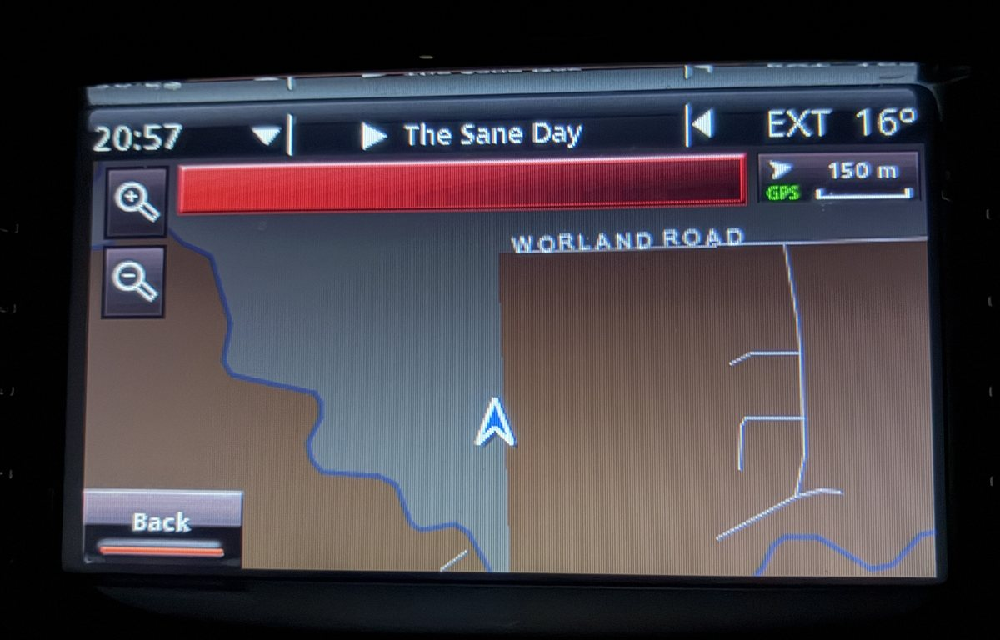
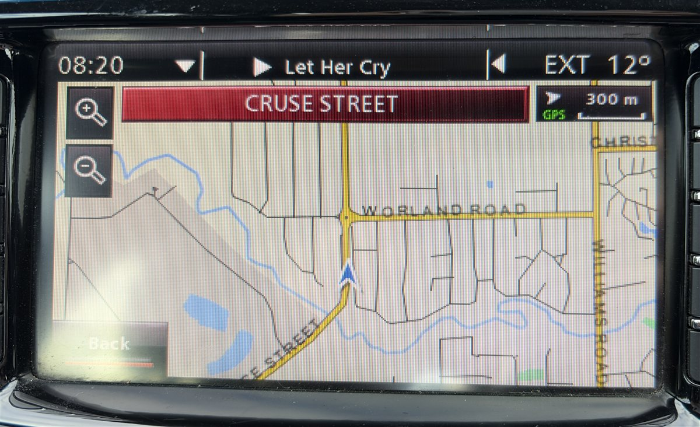

<p align="center">
  
</p>

<h1 align="center">OpenLion</h1>

<p align="center"><b>New maps for your Holden iQ satellite navigation, made from OpenStreetMap.</b></p>

<p align="center">
  <a href="https://github.com/hyprninja/OpenLion/releases/latest"><b>Download OpenLion for Windows</b></a>
  · <a href="#how-it-works">How it works</a>
  · <a href="#questions">Questions</a>
</p>

Holden stopped updating the iQ's maps in 2016. Whole suburbs and new roads built since then simply aren't there. OpenLion is a free Windows app that makes a new map card for your car from today's [OpenStreetMap](https://www.openstreetmap.org) data. It copies your factory card, builds fresh maps for Australia, New Zealand or both, and writes them to a spare SD card. Your factory card isn't changed.

| Before: factory card | After: OpenLion card |
|---|---|
|  |  |

Same spot, same car. The factory map stops at Worland Road. The OpenLion card shows Cruse Street and every street in the new estate.

## What you get

- **Every road in OpenStreetMap**, including streets built in the last ten years, with speed limits where OpenStreetMap has them.
- **Turn-by-turn guidance and voice instructions**, just like the factory maps. The new card uses the same map format, so the car reads it like its own.
- **Address search** by suburb, street and house number, with suburbs, councils and postcodes from OpenStreetMap.
- **Points of interest**: about 270,000 fuel stations, shops, cafés, hospitals and more.
- **Up-to-date data whenever you want it.** OpenStreetMap changes every day. Run OpenLion again any time for a new card.

## Will it work in my car?

OpenLion is for the **Holden iQ navigation in the VE Commodore Series II (MY11–MY16)**, the unit that reads its maps from a full-size SD card in the dash. It supports the MY12 (CD_7597), MY15 (CD_8217) and MY17 (CD_8418) factory cards. Other iQ card versions are checked before anything is built. If yours isn't supported yet, OpenLion says so, saves a report with no map data in it, and helps you send it in so support can be added.

## What you need

- A Windows 10 or 11 PC (64-bit) with **8 GB of memory or more** and **about 6 GB of free disk space**. More memory and cores make the build faster.
- Your **factory map card**. OpenLion only reads it. Instructions for removing the SD card can be found [here](https://www.autoinstruct.com.au/manufacturer/holden/ve-commodore/holden-iq-navigation-upgrade/).
- A **blank SD card** of 1 to 32 GB, formatted FAT32. A 2 GB card is plenty. Use a full-size card, or a microSD card in a full-size adapter.
- An internet connection for the map download (about 1 GB).
- **About half an hour to 2 hours**, depending on the PC. Most of it is the map build, which runs by itself.

## How it works

1. **Download and install** [OpenLion](https://github.com/hyprninja/OpenLion/releases/latest) (`OpenLion-1.2.0.msi`). It installs for your Windows account only and doesn't need administrator rights. Windows may warn that the app is from an unknown publisher, because it isn't code-signed yet. Click **More info**, then **Run anyway**.
2. **Read and accept the warning.** OpenLion is unofficial, and you use it at your own risk.
3. **Insert your factory card.** Set its lock switch first if you can. OpenLion copies it to your PC and checks every file, then checks that it understands your card's map format.
4. **Get the map data.** Choose Australia, New Zealand, or both (the factory card had both). OpenLion downloads the latest extract for each from OpenStreetMap (via Geofabrik) and checks it.
5. **Build the maps.** This takes about half an hour on a fast PC with plenty of memory, and up to 1½ hours on one with 8 GB. You can leave the PC to it; OpenLion keeps it awake.
6. **Write the new card.** Take out the factory card, insert the blank card and type its drive letter to confirm. OpenLion writes the maps, then reads every file back to check it.
7. **In the car:** with the car switched off, put the new card in the nav slot. Then start the car and wait for the map.

If anything isn't right, put your factory card back in. It's exactly as it was.

## Your factory card is protected

OpenLion only ever **reads** the factory card. Before it writes anything, it checks the target card several ways and refuses it if any check fails:

- Is this the factory card you copied (same volume serial)?
- Does it hold any navigation maps?
- Is the factory card still in the reader?
- Is any other card inserted?
- Is it a removable SD card of a sensible size, formatted FAT32?

It runs these checks again right before writing, in case cards were swapped. The new maps are written to a temporary folder and only become the card's maps once every file has been read back and checked.

## Questions

**Does this replace the factory software?** No. Only the map tables change. Every other file on the new card, including the software, voices and settings, is copied unchanged from your own factory card.

**Is it legal?** OpenLion includes no Holden, GM, Navteq or Continental data. It works only from the card you already own. The new maps are built from OpenStreetMap, which is free to use under the [Open Database License](https://opendatacommons.org/licenses/odbl/).

**Something went wrong. What now?** OpenLion saves a report (with no map data) and shows you how to [open an issue](https://github.com/hyprninja/OpenLion/issues/new/choose). Include your car's model and year and what happened.

**Can I improve the maps?** Yes. Anyone can edit OpenStreetMap at [openstreetmap.org](https://www.openstreetmap.org). Fix your street, and the next card you build will include it.

## Thanks

Thanks to **Jonny Bee**, who shared a copy of a MY17 card. That card is how OpenLion learned the newer map format, so MY17 cars can use it too.

Thanks to **Laurie N**, who shared a copy of a MY15 card, so MY15 cars can use OpenLion as well.

> **Disclaimer.** OpenLion is an unofficial tool, not made by, affiliated with or endorsed by Holden, General Motors or Continental. It is provided as is, with no warranty. You use it at your own risk: the author is not responsible for damaged or erased cards, a navigation unit that stops working, wrong directions, or anything else. Always follow road signs and the road rules over the navigation.
>
> Map data © [OpenStreetMap contributors](https://www.openstreetmap.org/copyright), available under the ODbL. The Australia and New Zealand extracts are provided by [Geofabrik](https://download.geofabrik.de). OpenLion is released under the [MIT License](LICENSE).

---

# Technical documentation

Everything below is for developers and anyone curious about how the iQ's maps work.

The iQ reads its maps from a full-size SD card. The map data turns out to be an unencrypted Siemens VDO / Continental database ("Arriba" data model, format 5.0.5) built from Navteq data. This repo documents that format and has readers and writers for it. The converter writes a new `navigation/` map set from OpenStreetMap and leaves the card's metadata, version files and libraries unchanged.

## Status

| Part | State | Doc |
|---|---|---|
| Card layout, FAT32, file inventory, zlib block container | Decoded | [01](docs/01_inventory_report.md) |
| Schema file `au.mod`, road/address index `.rd`, strings `.str` | Decoded, round-trip byte-identical | [02](docs/02_road_table_format.md) |
| Map tiles `mp0`: kd-tree, parcels, nodes, segments, lengths | Decoded | [03](docs/03_map_tiles_format.md) |
| Curve shapes, segment attributes `.si`, name links, speed limits | Decoded | [04](docs/04_shapes_attributes.md) |
| Turn restrictions, long nodes, cross-tile joins, one-way direction | Decoded | [05](docs/05_turns_nodes_joins.md) |
| Signposts, exit numbers, lanes, junction views | Decoded | [06](docs/06_signposts_lanes.md) |
| Background features `.fea` (water, parks, landuse, rail, overview roads) | Decoded | [07](docs/07_features_fea.md) |
| Routing layers `mg1`–`mg4` | Fully derivable from `mp0` | [08](docs/08_overview_layers.md) |
| Writers for every replaceable map table; identity card build is byte-identical (2,225/2,225 files) | Done | [09](docs/09_writer.md) |
| Address search: countries, states, counties, cities, speller trees, city/road lists | Decoded, round-trip byte-identical | [10](docs/10_search_tables.md) |
| Tiling + kd-tree build; mg1–mg4 derived from mp0 (re-tile test: all layers identical) | Done | [11](docs/11_tiling.md) |
| OSM import: roads, attributes, speed limits, turn restrictions → mp0 + mg1–mg4 (tested on inner Melbourne) | Working | [12](docs/12_osm_import.md) |
| OSM street names + address search: suburbs, LGAs, postcodes, road records, speller trees (tested on inner Melbourne) | Working | [13](docs/13_osm_names_search.md) |
| OSM background layer (`.fea`): water, parks, landuse, rail, coast/ocean, labels, overview roads (tested on Melbourne) | Working | [14](docs/14_osm_background.md) |
| Full-Australia build: all 17 tables in one run (`python -m openlion.pipeline`), lookups work in every capital | Done | [15](docs/15_full_australia.md) |
| Choose your country: Australia, New Zealand or both, each in its own search catalog; NZ suburbs from place points | Done | [18](docs/18_countries.md) |
| Test card assembly: complete `navigation/` folder with OSM maps, every other file byte-identical; read-back check passes | Done | [16](docs/16_test_card.md) |
| Points of interest from OSM (270k POIs, factory schema and compiled queries kept); CANBERRA as a municipality over its suburbs | Done | [17](docs/17_poi_canberra.md) |
| MY17 card (CD_8418, datamodel Arriba 5.3): newer road records, parcel header and speed limits; every table round-trips byte-identical | Done | [19](docs/19_my17_card.md) |
| MY15 card (CD_8217, AUNZ 2014Q1): 5.2.1 road records with the 5.3 map-file layout, detected from auz.mp0; every table round-trips byte-identical | Done | [schema.py](openlion/schema.py) |
| Builds on an 8 GB PC (about 3.6 GB peak) and in parallel on big ones (Australia + New Zealand in 25 min on 44 threads); output unchanged | Done | [20](docs/20_memory.md) |
| `.fea` size reduction, road-sense alerts (speed cameras, school zones) | Not started | |
| In-car test: unit accepts the OSM card, shows post-2010 streets, address search works, routes 200 km in demo mode, live guidance and voice instructions work on a real drive | Passed (2026-11-05) | [16](docs/16_test_card.md) |

Every structural claim in the docs was checked against the full factory dataset (for example, all 11,282 map parcels and 192,282 feature parcels decode and frame exactly).

## Repository layout

```
docs/        format reports, in the order they were worked out
docs/reference/manifest_sha256.tsv   file list + SHA-256 of the MY12 (CD_7606) card
openlion/    pure-Python (3.9+, standard library only) readers, writers and renderers
tests/       round-trip, re-tiling, OSM region and card checks against your own card copy
app/         Windows app (.NET 10, WPF): wizard that copies a factory card, builds maps and writes a blank card
packaging/   release build: embedded Python + engine + app → MSI (WiX 6)
```

### The Windows app

Version 1.0.0 is complete and car-tested. It has the wizard, drive detection, `CardGuard` (the checks that refuse to write to a factory card), and copying the factory card with every file hash-verified, followed by the compatibility check (`openlion.compat`). If a card isn't supported, the app saves a report zip (no map data) and points the user to the [card report issue form](.github/ISSUE_TEMPLATE/card_report.yml). The app downloads the Australia extract from Geofabrik (resumable, MD5-checked; or the user picks a `.osm.pbf` they already have) and builds the maps with `openlion.make_card`, showing progress per stage. It then writes the maps to a blank FAT32 card: `CardGuard` runs again on a fresh drive list right before writing, the files go to `navigation.partial` and are read back from the card and hash-checked before the folder is renamed, and the card gets the factory card's volume label. A full run (fresh download, 1 h 13 min build, peak engine memory 16.6 GB, 3 min write) made a card that works in the car.

Version 1.2.0 adds the MY15 card (CD_8217), shows each card by its model year (MY12, MY15, MY17), and hardens the app after a security review: damaged card tables are caught with a clear message, build caches are hash-checked, bundled Python packages are pinned by SHA-256, error reports hide more of the user's paths, and every change is built and tested by CI. Version 1.1.0 added New Zealand, the MY17 card format, and a build that adapts to the PC: in about 3.6 GB on an 8 GB PC, or with every core and much more memory on a big one, with the same maps either way (report [20](docs/20_memory.md)).

The installed app is self-contained: the .NET runtime, an embedded Python 3.12 with `osmium`, and the engine (`openlion/`, the `tests/` checks and the reference manifest) all sit in its folder. Nothing else needs to be installed.

To build the MSI (needs the .NET 10 SDK, WiX 6 and any Python with pip):

```powershell
dotnet tool install -g wix --version 6.0.2
wix extension add -g WixToolset.UI.wixext/6.0.2
pwsh packaging/build-release.ps1 -Version 1.1.0     # → dist/OpenLion-1.1.0.msi (+ .sha256)
```

Build and test the app with `dotnet test app/OpenLion.slnx`. Settings for development:

| Variable | Effect |
|---|---|
| `OPENLION_HOME` | Keep the app's working files here instead of `%LOCALAPPDATA%\OpenLion` |
| `OPENLION_PYTHON`, `OPENLION_ENGINE` | Python with `osmium` installed, and the folder holding `openlion/` (used when there's no bundled engine next to the app) |
| `OPENLION_BBOX` | Build only this area, e.g. `148.76 -35.92 149.40 -35.12` (Canberra), for quick test builds; the app marks the result as a test build |
| `OPENLION_FACTORY_NAV` | A factory `navigation/` copy, to run the full compatibility test |

| Module | Purpose |
|---|---|
| `flat.py` | Unpack and re-pack `zip\x01` FLAT tables |
| `common.py` | Shared 0x5E table header |
| `roads.py` | Road / address index (`.rd`) and street names (`.str`): read + write |
| `mapfile.py` | Map tiles (`mp0`, `mg1`–`mg4`) reader: nodes, segments, shapes, attributes, names, speeds, turn bans, signposts, lanes |
| `mapwrite.py` | Map tile writer: parcel container, list codecs, file assembly |
| `features.py` / `feawrite.py` | Background feature file (`.fea`) reader / writer |
| `search.py` | Address-search tables and speller trees: read, write, build, validate |
| `graph.py` | Layout-independent road graph + extractor from any map file |
| `tiler.py` | Graph → map file: kd-tree, parcels, border copies, all lists |
| `layers.py` | Derive routing layers mg1–mg4 from the mp0 graph |
| `osm_import.py` | OpenStreetMap (.pbf, via `osmium`) → road graph + seginfo table |
| `osm_names.py` | OSM boundaries + names → road records, cities and all search tables |
| `osm_fea.py` | OSM areas/lines/coastline → background feature file |
| `osm_poi.py` | OSM amenities → POI database (SQLite), keeping the factory schema and statements |
| `pipeline.py` | One command: OSM extract → every replaceable table (cached stages, checks, sample lookups) |
| `make_card.py` | What the app runs: pipeline → `build` → `tests/card_check.py` into a finished `navigation/` folder, with JSON progress (`--json`); OSM reads are cached until the extract changes; each cache file carries a SHA-256 and is re-read if it doesn't match |
| `build.py` | Writes a complete `navigation/` folder (`--identity` or `--tables <dir>`), replacing only map tables and hash-verifying everything else |
| `render.py`, `render_fea.py` | Draw decoded roads / features to PNG, no third-party libraries |
| `fat32_list.py` | Read-only file lister + hasher for a raw SD image |
| `compat.py` | Card compatibility check: re-encodes every replaceable table of a card and requires byte-identical output (`--json` for the app); reports hold no map data |

Typical use, from the repo root, given your own copy of a card's `navigation/` folder:

```bash
python -m openlion.flat navigation/db_aunz/db/auz.si auz.si.raw
python -m openlion.render navigation/db_aunz/db/auz.mp0 auz.si.raw out.png 144.95 -37.86 145.06 -37.79
python tests/roundtrip.py navigation/db_aunz/db
python -m openlion.compat navigation
python -m openlion.build navigation out/navigation --identity
python tests/retile.py navigation/db_aunz/db
python -m openlion.pipeline australia-latest.osm.pbf navigation/db_aunz/db osm_out
python -m openlion.build navigation card/navigation --tables osm_out/db --poi osm_out/edb/POI/aunz_sql.db3
python tests/card_check.py card/navigation navigation
python -m openlion.make_card australia-latest.osm.pbf navigation osm_work card2/navigation   # all of the above in one
python -m openlion.make_card AU=australia-latest.osm.pbf navigation osm_work card3/navigation --extract NZ=new-zealand-latest.osm.pbf   # both countries
```

## Legal and data policy

- **No factory map data is in this repo**: no card contents, no decoded tables, no renders made from factory data, no junction-view artwork. (The "before" picture is a photo of the car's own screen.) The Whereis/Navteq/Holden map data and GM/Continental software are proprietary. Work from your own card.
- Format documentation and tools are original work.
- Maps built from OpenStreetMap are © OpenStreetMap contributors and must be distributed under the **ODbL**, with attribution.

## Safety

Treat your original card as read-only. Image it, ideally with the lock switch on and a reader that honours it, and experiment only on copies written to a separate full-size SD card.
