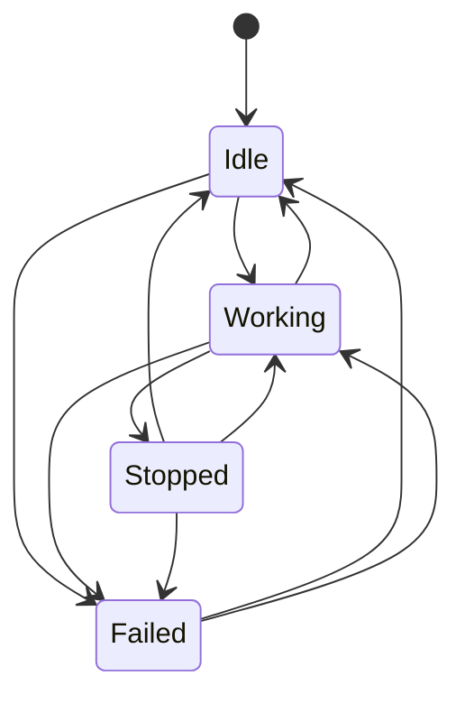
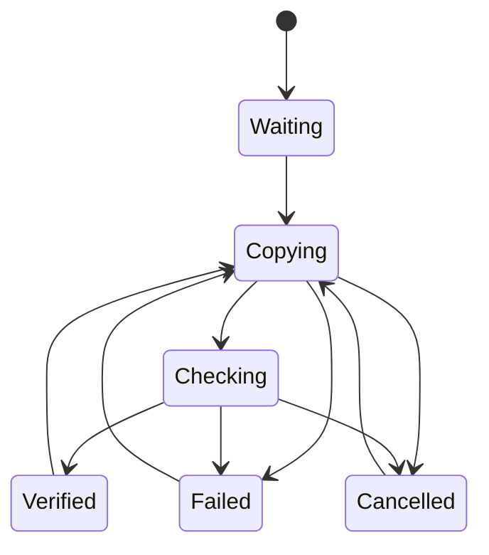
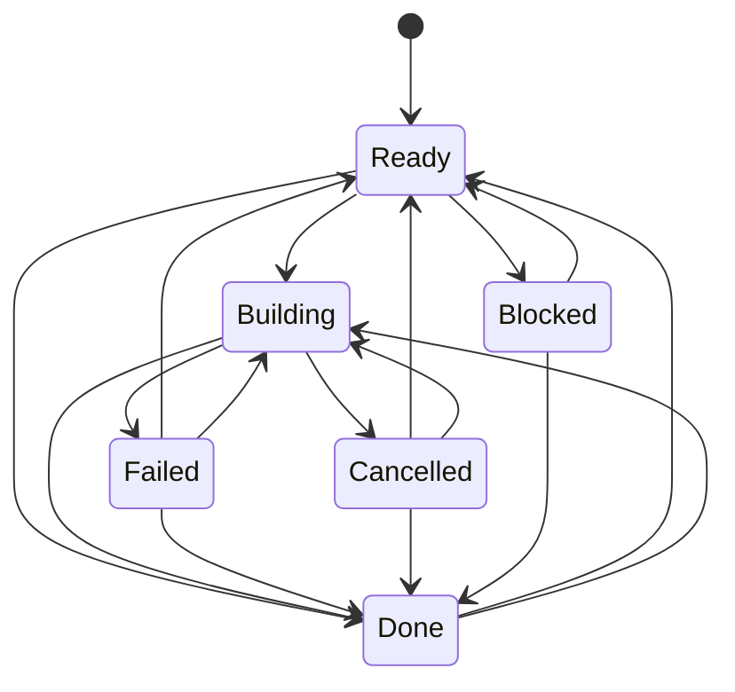
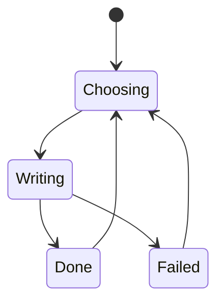
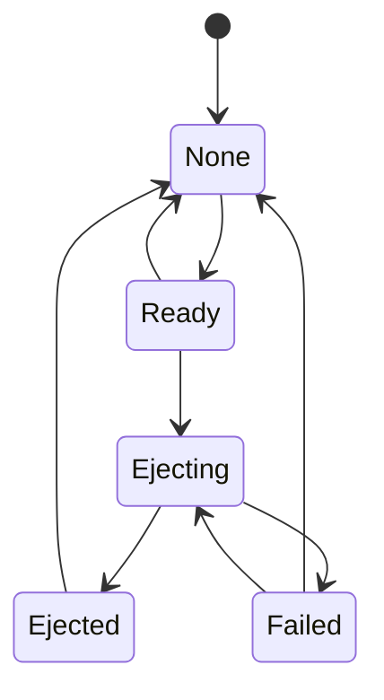

# 28. App states

Generated from [`app/src/OpenLion/ViewModels/Flows.cs`](../app/src/OpenLion/ViewModels/Flows.cs) by
`AppFlowTests`: don't edit it by hand. After changing a flow, run the app tests with `OPENLION_UPDATE_DOCS=1`
to rewrite it; without that, the tests fail while it's out of date.

Each machine below is the table the app runs from. Every move is written to `app.log` as
`state: <machine> <from> -> <to>`, and every step change as `state: wizard <step> -> <step>`, so a log
reads as one timeline. A move a table doesn't list is still made (the app never stops the user over it)
but is logged as `UNDECLARED`, which is a bug to fix here or in the step.

Not machines, on purpose: what a download row shows (nothing yet / latest / newer online / couldn't
check) is worked out from what's on disk and what the last check found, so it can't get out of step; and
the engine's build stages are the ordered `STAGES` list in `openlion/make_card.py`.

## activity

The foreground job on a download step (Get OSM data, Speed data, House numbers, Voice): a download, an import, or an immediate problem such as a missing engine. Checking what's online runs alongside it (IsChecking) and is not part of this machine. A stop is not a failure: it shows a neutral notice.

Logged as `osm`, `speed`, `gnaf` and `voice`, one for each step that runs it.

## copy

Copy card: copy the factory card and check every file, then check OpenLion can re-create its map tables byte for byte. Only Verified lets the wizard go on.

## build

Build maps: run the engine. Entering the step lands on Done (an earlier build still matches), Ready, or Blocked (the copy or the OSM data is missing). Only Done lets the wizard go on.

## write

Write new card: choose a card CardGuard allows, then write, read back and check. The guard runs again on a fresh drive list right before Writing.

## eject

After a write, on macOS: eject the card from the app. Writing again starts over at None.

